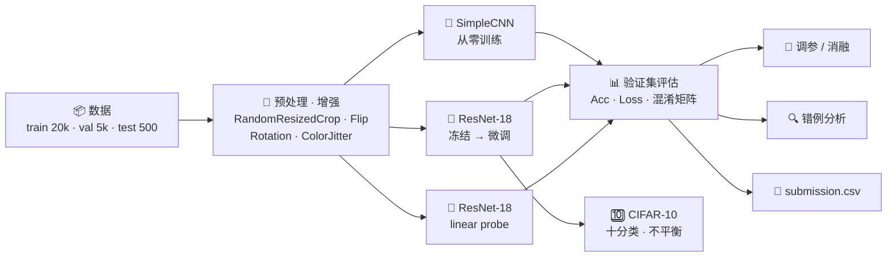

<div align="center">

# 🐶 Dogs vs. Cats 🐱

### 从零训练的 CNN vs ImageNet 预训练迁移学习：猫狗二分类及向 CIFAR-10 的迁移

*Binary Image Classification with Transfer Learning — EE6483 Mini Project (Option 2)*


[报告问题参考答案](doc.md) · [协作指南（Git 工作流）](CONTRIBUTING.md) · [提交文件](submission.csv) · 项目要求原文见课程 NTULearn（EE6483-Project2.pdf）

</div>

---

## 🧐 这个项目在做什么？（通俗版）

给电脑一张照片，让它判断里面是 **猫 🐱 还是狗 🐶**。人一眼就能看出来，但对电脑来说，同一只猫可以有不同的姿势、光照、背景、品种，还可能只露出半张脸。

我们比较了几种让电脑"学会认猫狗"的方法：

| | 方法 | 打个比方 |
|---|---|---|
| 🧱 | **SimpleCNN（从零训练）** | 一个从没见过世界的新手，只看这 2 万张图自学，**慢，而且学得不够好** |
| 🧠 | **ResNet-18（ImageNet 预训练 + 微调）** | 已经看过 120 万张、1000 类图片的"老手"，只需要稍微教一下猫狗的区别，**快且准** |
| 📐 | **ResNet-18 只训线性头（linear probe）** | 老手的知识原封不动，只在最后加一个线性分类器做决定（等价于在预训练特征上做逻辑回归） |

**我们要回答的问题**：预训练到底带来多大好处？学习率、数据增强、训练数据量这些因素各有多重要？同一套方法换到 10 分类的 CIFAR-10 上还行吗？

> **English abstract.** We classify dog vs. cat images (20k train / 5k val / 500 test) with a CNN trained from scratch and an ImageNet-pretrained ResNet-18 that is first linear-probed and then fully fine-tuned. The fine-tuned ResNet-18 reaches 99.0% validation accuracy in about 6 minutes, versus 95.2% for the from-scratch CNN after 46 minutes. We compare learning rates on Dogs vs. Cats. The transferred training pipeline reaches 93.63% accuracy on the official CIFAR-10 test set. We also compare class weighting and oversampling on a fixed imbalanced split.

---

## 🗺️ 整体流程



## ❓ 报告要回答的问题

| 题 | 内容 | 分值 | 负责 | 怎么回答 |
|:-:|---|:-:|:-:|---|
| **a** | 文献综述与 baseline 论证 | 20% | B | 综述 + 论证选 ResNet 迁移学习作 baseline |
| **a′** | 数据量、预处理与增强 | 5% | 用户 | 数据统计 + 增强流程 + 增强示意图 |
| **b** | 模型结构、loss、训练策略、代码、可复现 | 15% | 用户 | 架构图 + 维度表 + 本 README + 3 seed |
| **c** | 参数如何确定 | 5% | 用户 | 学习率等对比实验 |
| **d** | 验证集准确率、test 预测 | 15% | 用户 | 结果表 + `submission.csv` |
| **e** | test 正确 / 错误样例分析 | 10% | 用户 | 最有把握 / 最没把握 / 预测错的样例图 |
| **f** | 不同模型与数据处理对准确率的影响 | 10% | 用户 | 模型对比表 + 增强 × 数据量消融 |
| **g** | 迁移到 CIFAR-10 | 10% | C | [正式结果](CIFAR10_RESULTS.md) |
| **h** | CIFAR-10 类别不平衡 | 10% | C | [正式结果](CIFAR10_RESULTS.md) |

各题的详细答案素材见 **[doc.md](doc.md)**，待跑实验的命令见 **[EXPERIMENTS.md](EXPERIMENTS.md)**。

---

## ⚡ 快速开始

推荐用 [conda](https://docs.conda.io/)（Anaconda / Miniconda / Miniforge 均可）配置环境。以下命令在 Windows、Linux、macOS 上通用。

### 1️⃣ 创建并激活 conda 环境

```bash
conda create -n ee6483 python=3.12 -y
conda activate ee6483
```

> Python 3.10 及以上都可以。

### 2️⃣ 安装 PyTorch（⚠️ 按自己的设备选择）

PyTorch 要和你电脑的显卡、驱动匹配，所以**没有写进 `requirements.txt`**，需要单独安装。

**第一步：查看你的设备。**

| 你的设备 | 怎么确认 | 安装哪个版本 |
|---|---|---|
| 🟩 NVIDIA 显卡 | 终端运行 `nvidia-smi`，右上角显示 `CUDA Version: XX.X` | 选择 **不高于** 这个数字的 CUDA 版本 |
| 🍎 Apple 芯片 Mac（M1 / M2 / M3 / M4） | — | 默认版本即可，代码会自动使用 MPS 加速 |
| 💻 没有独立显卡 | `nvidia-smi` 报错或找不到命令 | CPU 版本（能跑，但训练会很慢，建议用小数据量） |

> `nvidia-smi` 显示的是**驱动最高支持**的 CUDA 版本。安装比它低的 CUDA 版本没有问题，安装比它高的就不行。

**第二步：打开 [PyTorch 官网安装页](https://pytorch.org/get-started/locally/)**，依次选择 `Stable` → 你的系统 → `Pip` → `Python` → 对应的 CUDA 版本（或 CPU），复制生成的命令运行。命令一般长这样：

```bash
pip install torch torchvision --index-url https://download.pytorch.org/whl/cu<版本号>
```

例如我们的开发机（RTX 5070 Ti，驱动支持 CUDA 13.3）用的是 `cu132`。

**第三步：检查是否安装成功。**

```bash
python -c "import torch, torchvision; print(torch.__version__, torchvision.__version__, 'CUDA:', torch.cuda.is_available())"
```

NVIDIA 显卡用户应该看到 `CUDA: True`。如果是 `False`，说明装成了 CPU 版本，或者 CUDA 版本选高了：先 `pip uninstall torch torchvision`，再重新选择版本安装。

> 代码要求 torch ≥ 2.3、torchvision ≥ 0.18。

### 3️⃣ 安装其余依赖

```bash
pip install -r requirements.txt
```

### 4️⃣ 准备数据

把老师提供的数据集解压到 `dog_vs_cat/datasets/`，目录结构如下：

```
datasets/
├── train/{cat,dog}/   每类 10000 张
├── val/{cat,dog}/     每类 2500 张
└── test/              1.jpg ~ 500.jpg
```

### 5️⃣ 运行

以下命令都在 `dog_vs_cat/` 目录下执行：

```bash
# 冒烟测试：每类 100 张、2 个 epoch，确认环境没问题（GPU 上约 1 分钟）
python src/train.py --config configs/resnet18_ft.yaml --set train_per_class=100 epochs=2 exp_name=smoke

# 训练主模型（RTX 5070 Ti Laptop 上约 6 分钟）
python src/train.py --config configs/resnet18_ft.yaml

# 生成提交文件
python src/predict.py --ckpt outputs/resnet18_ft_s42/best.pt --out submission.csv
```

### 🩺 常见问题

| 现象 | 解决办法 |
|---|---|
| `CUDA out of memory` | 显存不够，减小 batch：`--set batch_size=32`（或 16） |
| 训练很慢 / CPU 占满 / 内存不足 | 减少数据加载进程：`--set num_workers=2`；也可以先用 `train_per_class=1000` 小数据量实验 |
| Windows 上卡在第一个 epoch 不动 | 试试 `--set num_workers=0` |
| `ModuleNotFoundError: No module named 'torchvision'` | 回到第 2 步安装 PyTorch |
| 没有 GPU | 可以用 Google Colab / Kaggle Notebook 的免费 GPU 运行 |

### 🛠️ 我们的实验环境（报告中的结果均在此环境得到）

| 项 | 版本 |
|---|---|
| 系统 | Windows 11 + conda |
| Python | 3.12 |
| PyTorch / torchvision | 2.14.0+cu132 / 0.29.2+cu132 |
| GPU | NVIDIA RTX 5070 Ti Laptop（12 GB） |

### 🎛️ 调参：两种方式

**命令行临时覆盖**，适合快速试。`--set` 后面可以跟多个 `key=value`：

```bash
python src/train.py --config configs/resnet18_ft.yaml --set lr=5e-4 seed=1 exp_name=r18_lr5e-4
```

**复制一份 yaml 再改**，适合要写进报告的正式实验。文件名自动作为实验名：

```bash
python src/train.py --config configs/my_exp.yaml
```

> ⚠️ 输出目录是 `outputs/<exp_name>_s<seed>/`。**每次实验请换一个 `exp_name`**，否则会覆盖之前的结果。

常用配置项如下，完整列表和默认值见 [`src/utils.py`](src/utils.py) 中的 `DEFAULTS`。

| 参数 | 含义 | 可选值 |
|---|---|---|
| `model` | 模型 | `simple_cnn` / `resnet18` / `resnet34` / `resnet50` |
| `pretrained` | 是否加载 ImageNet 预训练权重 | `true` / `false` |
| `freeze_epochs` | 前 N 个 epoch 冻结 backbone | `0` 不冻结 · `1` · `-1` 全程冻结（linear probe） |
| `lr` | 分类头学习率 | `1e-2` / `1e-3` / `5e-4` / `1e-4` |
| `backbone_lr_mult` | backbone 学习率 = `lr` × 该值 | `0.1` · `1` |
| `optimizer` | 优化器 | `adamw` / `sgd` |
| `augment` | 训练集是否做数据增强 | `true` / `false` |
| `train_per_class` | 每类训练样本数（分层抽样） | `null` 用全部 · `1000` 共 2k 张 |
| `epochs` · `batch_size` · `seed` | 训练轮数 · 批大小 · 随机种子 | — |

> ⚠️ 训练 SimpleCNN 时，必须同时设 `pretrained=false freeze_epochs=0 backbone_lr_mult=1`，因为默认值是为预训练模型准备的。

### 📂 每个实验的输出

| 文件 | 内容 |
|---|---|
| `config.yaml` | 本次实验的完整配置 |
| `history.csv` | 每个 epoch 的 lr、train/val 的 loss 与 acc、耗时 |
| `curves.png` | 训练 / 验证曲线 |
| `best.pt` | 验证集准确率最高时的权重 |
| `metrics.json` | 最佳 val acc、对应 epoch、混淆矩阵、训练耗时 |
| `val_preds.npz` | 验证集每张图的预测概率，用于错例分析 |
| `test_preds.csv` | 运行 `predict.py` 后生成，含 test 每张图的 dog 概率 |

### 🔁 正式实验命令

```bash
# c：学习率（还差 lr=1e-2，用来作为"学习率过大"的对照）
python src/train.py --config configs/resnet18_ft.yaml --set lr=1e-2 exp_name=r18_lr1e-2
# c：优化器
python src/train.py --config configs/resnet18_ft.yaml --set optimizer=sgd lr=1e-2 exp_name=r18_sgd
# f：冻结 vs 微调
python src/train.py --config configs/resnet18_ft.yaml --set freeze_epochs=-1 exp_name=r18_linear_probe
# f：增强 × 数据量
python src/train.py --config configs/resnet18_ft.yaml --set lr=5e-4 train_per_class=1000 exp_name=r18_2k_aug
python src/train.py --config configs/resnet18_ft.yaml --set lr=5e-4 train_per_class=1000 augment=false exp_name=r18_2k_noaug
python src/train.py --config configs/resnet18_ft.yaml --set lr=5e-4 augment=false exp_name=r18_20k_noaug
# f：从零训练的 CNN
python src/train.py --set model=simple_cnn pretrained=false freeze_epochs=0 backbone_lr_mult=1 epochs=20 exp_name=simple_cnn
# b：主模型 3 个 seed
python src/train.py --config configs/resnet18_ft.yaml --set lr=5e-4 seed=1 exp_name=r18_main
```

---

## 📁 项目结构

```
dog_vs_cat/
├── 📄 README.md              ← 你在这里
├── 🤝 CONTRIBUTING.md        协作指南：Git 分支 + PR 工作流
├── 📝 doc.md                 报告各题的参考答案素材（给写报告的同学）
├── 📝 submission.csv         test 预测结果（id,label；1=dog，0=cat）
├── 📋 requirements.txt       除 PyTorch 外的依赖
├── ⚙️ configs/               每个实验一个 yaml
├── 📦 datasets/              train/{cat,dog} · val/{cat,dog} · test（不进 Git）
├── 📊 outputs/               每个实验一个文件夹 <exp_name>_s<seed>/
└── 🐍 src/
    ├── utils.py              set_seed · 默认配置 DEFAULTS · load_config · 混淆矩阵
    ├── data.py               预处理与增强 · ImageFolder · 分层子采样 · test 读取
    ├── models.py             build_model(name, num_classes) · 冻结 / 分组学习率
    ├── train.py              训练循环（AMP · cosine · 先冻结后微调）· 保存曲线与指标
    ├── predict.py            test 推理 → submission.csv（可选 --tta 翻转增强）
    └── analyze.py            混淆矩阵 · 验证错例 · 测试图人工复核
```

### 🔟 CIFAR-10 与不平衡实验

共用同一训练入口；四组实验命令、数据划分与指标解释见 [补充实验指南](EXPERIMENTS.md#cifar-10gh)。[查看四组正式结果](CIFAR10_RESULTS.md)。


---

## 👥 团队

> 🤝 参与开发前请先读 **[协作指南](CONTRIBUTING.md)**：每项任务新建自己的分支，做完提 PR 合并，不直接改 `main`。

| 成员 | 负责内容 |
|:-:|---|
| 🟥 **用户（姓名待填）** | 代码框架 · 猫狗分类全部实验 · |
| 🟧 **同学 B（姓名待填）** | 文献综述 · baseline 论证 · 报告统稿与引用 ||
| 🟦 **同学 C（姓名待填）** | CIFAR-10 迁移 · 类别不平衡实验 |

## 📅 进度

| 日期 | 内容 | 状态 |
|---|---|:-:|
| 11/7 六 | 环境 · 代码框架 · ResNet-18 跑通 · 第一版 submission | ✅ |
| 11/8 日 | 三种模型对比（SimpleCNN ✅ · linear probe ✅） | ✅ |
| 11/9 一 | 消融与调参 · 交接口给 C | 🟡 |
| 11/10 二 | 3 seed 复现 · 错例分析 · 出图 | ⬜ |
| 11/11 三 | 写 b–f | ⬜ |
| 11/12 四 | 合稿 · 贡献说明 | ⬜ |
| 🏁 11/13 五 | 23:59 前提交到 NTULearn | ⬜ |

<sub>⬜ 未开始　🟡 进行中　✅ 已完成</sub>

---

## 📊 主要结果

验证集 5000 张（每类 2500），均为 seed 42。

| 实验 | 模型 | 关键设置 | Val Acc | Val Loss | 耗时 |
|---|---|---|:-:|:-:|:-:|
| r18_lr5e-4 | ResNet-18 | lr 5e-4，冻结 1 → 微调 5 | **99.02%** | **0.028** | 5.7 min |
| resnet18_ft | ResNet-18 | lr 1e-3 | 98.96% | 0.032 | 5.4 min |
| r18_lr1e-3 | ResNet-18 | lr 1e-3（与上一行配置相同） | 98.94% | 0.032 | 5.6 min |
| r18_lr1e-4 | ResNet-18 | lr 1e-4 | 98.88% | 0.031 | 5.7 min |
| simple_cnn | SimpleCNN | 从零训练 20 epoch | 95.24% | 0.130 | 45.9 min |
| r18_linear_probe | ResNet-18 | 全程冻结 backbone，只训线性头，lr 5e-4 | 98.42% | 0.043 | 2.0 min |

> 🔎 val 有 5000 张，准确率 99% 附近时的标准误差约为 0.14%。三个学习率之间的差异在这个范围内，需要多 seed 才能下结论。

<!-- 出图后取消注释：

-->

---

## 🧪 我们如何保证结果可信

- **不偷看答案**：只用 train 训练，用 val 选模型和参数；test 只用于最后生成 `submission.csv`
- **可复现**：固定 python / numpy / torch 随机种子，DataLoader 使用固定的 generator 和 worker seed；每次实验都保存完整的 `config.yaml`
- **多次运行**：默认开启 cudnn benchmark 加速，会带来微小的非确定性（同一配置两次运行相差约 0.02%），可用多个 seed 报告均值与标准差（目前仅记录 seed 42）；需要严格确定性时加 `--set deterministic=true`
- **同一把尺子**：所有模型使用相同的数据划分、相同的验证集预处理和相同的评估代码

## 📚 参考文献

> 完整文献列表由 B 整理，见报告 a 部分。

1. He, K., Zhang, X., Ren, S., & Sun, J. (2016). Deep Residual Learning for Image Recognition. *CVPR*.
2. Simonyan, K., & Zisserman, A. (2014). Very Deep Convolutional Networks for Large-Scale Image Recognition. *arXiv:1409.1556*.
3. Deng, J., et al. (2009). ImageNet: A Large-Scale Hierarchical Image Database. *CVPR*.
4. Loshchilov, I., & Hutter, F. (2019). Decoupled Weight Decay Regularization. *ICLR*.
5. Kaggle. Dogs vs. Cats. https://www.kaggle.com/c/dogs-vs-cats

---

<div align="center">
<sub>EE6483 Artificial Intelligence and Data Mining · Nanyang Technological University · 2026</sub>
</div>
