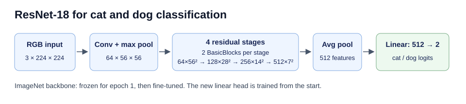

# 📝 EE6483 Mini Project (Option 2) — 报告各题参考答案素材

> **给写报告的同学**：这份文档按老师要求的题目顺序，整理了每题"应该写什么"以及我们实际做了什么、得到的数字。
> 正文可以直接改写成英文报告。
>
> - ✅ 已有结果，可以直接写
> - ⏳ 实验还没跑完，数字待补（会持续更新）
>
> 所有数字都来自 `outputs/<实验名>/metrics.json` 和 `history.csv`，写报告时请以最新版本为准。
> 题目原文见课程 NTULearn 上的 `EE6483-Project2.pdf`（不在本仓库中）。

**目录**
[a 文献综述](#a-文献综述20负责b) · [a′ 数据与预处理](#a-数据量预处理与增强5) · [b 模型](#b-模型结构训练策略与可复现性15) · [c 参数选择](#c-参数如何确定5) · [d 结果](#d-验证集准确率与-test-预测15) · [e 样例分析](#e-test-正确--错误样例分析10) · [f 对比](#f-不同模型与数据处理的影响10) · [g CIFAR-10](#g-迁移到-cifar-1010负责c) · [h 不平衡](#h-cifar-10-类别不平衡10负责c) · [贡献说明](#-成员与贡献) · [参考文献](#-参考文献)

---

## a) 文献综述（20%，负责：B）

> 这部分主要由 B 完成。下面列出建议的结构和关键文献，**重点是 a(4) 的 baseline 论证必须和我们实际用的方法一致**。
> 文献信息写进报告前请 B 自行核对原文（作者、年份、会议）。

### a(1) 问题定义、挑战与不同设定

**问题定义**：给定一张 RGB 图像 x，预测标签 y ∈ {0 = cat, 1 = dog}。这是一个**有监督的闭集二分类**问题，属于细粒度程度较低的图像分类。Dogs vs. Cats 最早来自微软的 Asirra 验证码项目 [Elson et al., 2007]，当时它被设计为"人类容易、机器困难"的任务。

**主要挑战**（可以配几张我们数据集中的例子图）：
- 类内差异大：品种、毛色、体型差异很大，还包括幼崽和成年个体
- 类间相似：一些小型犬和猫在外形、毛色上很接近
- 姿态、遮挡、截断：只露出部分身体、被人或物体遮挡
- 背景杂乱、光照变化、图像分辨率低（我们的数据中最小的只有 42×32 像素）
- 一张图里有多只动物，甚至同时有猫和狗
- 可能存在标注噪声（待 e 题错例分析时确认）

**不同设定下的常见解法**：

| 设定 | 含义 | 常见方法 |
|---|---|---|
| 有监督 | 每张训练图都有标签（**我们的设定**） | CNN 从零训练；ImageNet 预训练后微调 [He et al., 2016; Yosinski et al., 2014] |
| 无监督 / 自监督 | 没有标签，或先用无标签数据学表示 | 对比学习 SimCLR [Chen et al., 2020]、MoCo [He et al., 2020]；掩码重建 MAE [He et al., 2022]；DINO [Caron et al., 2021]。学到表示后用少量标签做线性分类 |
| 闭集 | 测试图只会是训练见过的类别（**我们的设定**：只有猫和狗） | 普通 softmax 分类器 |
| 开集 | 测试时可能出现未知类别（比如一张兔子的照片） | 需要拒识未知类：OpenMax [Bendale & Boult, 2016]、基于置信度阈值的方法；问题定义见 [Scheirer et al., 2013] |
| 无 domain shift | 训练和测试来自同一分布（**我们的设定**：train/val/test 来自同一数据源） | 标准训练即可 |
| 有 domain shift | 测试分布不同（比如训练用照片、测试用卡通图） | 域自适应 DANN [Ganin & Lempitsky, 2015]；强数据增强；大规模预训练模型（如 CLIP [Radford et al., 2021]）的零样本能力 |

### a(2) 近年高关注论文（建议覆盖的方向）

- **CNN 架构**：AlexNet (2012) → VGG [Simonyan & Zisserman, 2014] → ResNet [He et al., 2016] → ConvNeXt [Liu et al., 2022]
- **Transformer**：ViT [Dosovitskiy et al., 2021]
- **迁移学习**：特征的可迁移性 [Yosinski et al., 2014]；更好的 ImageNet 模型是否迁移得更好 [Kornblith et al., 2019]；BiT 大规模预训练 [Kolesnikov et al., 2020]
- **自监督预训练**：SimCLR、MoCo、MAE、DINO
- **视觉-语言模型**：CLIP（零样本分类，"a photo of a cat" vs "a photo of a dog"）
- **数据增强与训练技巧**：AutoAugment / RandAugment [Cubuk et al., 2019; 2020]、mixup [Zhang et al., 2018]、CutMix [Yun et al., 2019]、label smoothing [Szegedy et al., 2016]、AdamW [Loshchilov & Hutter, 2019]、cosine 学习率 [Loshchilov & Hutter, 2017]
- **猫狗专门工作**：Asirra 验证码 [Elson et al., 2007]；用 SVM + 颜色/纹理特征攻破 Asirra [Golle, 2008]；Oxford-IIIT Pet 细粒度猫狗品种数据集 [Parkhi et al., 2012]

### a(3) 精读 1–2 个顶尖团队（建议）

**推荐：Kaiming He 团队（MSRA → FAIR → MIT）**。理由是这条线和我们的方法直接相关，叙事完整：
1. **ResNet** [He et al., 2016]：残差连接解决深层网络的退化问题，是我们使用的 backbone
2. **MoCo** [He et al., 2020]：动量对比的自监督预训练，说明不用标签也能学到可迁移的特征
3. **MAE** [He et al., 2022]：掩码自编码器，把 BERT 式预训练搬到视觉领域

备选：Google Research / Brain 团队（ViT、SimCLR、BiT），主线是"大规模预训练 + 迁移"。

### a(4) baseline 选择与改进方向（⚠️ 必须与实际方法一致）

- **baseline**：ImageNet 预训练的 **ResNet-18 + 线性分类头**。
  - 理由：猫狗是 ImageNet 1000 类中已经大量出现的概念（ImageNet 中有许多犬种和猫类），预训练特征高度相关 [Yosinski et al., 2014; Kornblith et al., 2019]。
  - ResNet-18 只有 11.2M 参数，在笔记本 GPU 上约 1 分钟训练一个 epoch，适合我们的计算资源。
  - 老师在项目说明中也建议使用 VGG / ResNet 这类预训练 backbone。
- **对照组**：从零训练的 SimpleCNN，用来量化预训练带来的提升；全程冻结 backbone、只训线性头的 linear probe，用来量化微调带来的提升。
- **改进方向**（我们实际做了的）：
  1. **两阶段训练**：先冻结 backbone 只训线性头（linear probe），再整体微调。backbone 学习率是分类头的 0.1 倍，以免破坏预训练特征。
  2. **数据增强**：RandomResizedCrop、水平翻转、小角度旋转、ColorJitter，以提升对姿态、取景和光照的鲁棒性。
  3. **优化**：AdamW、cosine 学习率衰减、混合精度训练。
- **可以提但我们没有做的方向**（写成 future work）：更大的 backbone（ResNet-50、ConvNeXt、ViT）、CLIP 零样本或微调、mixup / CutMix、模型集成。

---

## a′) 数据量、预处理与增强（5%）✅

### 数据量

| 划分 | cat | dog | 合计 | 用途 |
|---|:-:|:-:|:-:|---|
| train | 10,000 | 10,000 | **20,000** | 只用于训练（反向传播更新参数） |
| val | 2,500 | 2,500 | **5,000** | 只用于选模型和调参，不参与训练 |
| test | — | — | **500** | 无标签，只用于生成 `submission.csv` |

- 主实验使用**全部** train 和 val 数据。
- 数据量消融（f 题）使用 `train_per_class=1000`：每类分层随机抽 1000 张，共 **2,000 张**，抽样由 seed 固定。val 不变。
- 标签编号：`ImageFolder` 按文件夹名字母序编号，cat = 0、dog = 1，正好与提交要求（1 = dog，0 = cat）一致。

### 原始图像统计

图片尺寸不一，需要统一缩放：

| 划分 | 宽：中位数（最小–最大） | 高：中位数（最小–最大） |
|---|---|---|
| train | 448（42–1050） | 374（32–768） |
| val | 447（51–500） | 374（37–500） |
| test | 435（37–500） | 374（50–500） |

### 预处理与增强流程

代码见 `src/data.py` 中的 `build_transforms`。

**训练集**（每个 epoch 随机生成，同一张图每次看到的都不一样）：

| 步骤 | 操作 | 参数 | 目的 |
|:-:|---|---|---|
| 1 | RandomResizedCrop | 输出 224×224，面积比例 0.6–1.0 | **缩放 + 裁剪**：模拟不同的取景和远近，同时把尺寸统一为 224 |
| 2 | RandomHorizontalFlip | p = 0.5 | **翻转**：左右翻转后类别不变 |
| 3 | RandomRotation | ±15° | **旋转**：模拟拍摄时相机倾斜 |
| 4 | ColorJitter | 亮度 / 对比度 / 饱和度 ±0.2，色调 ±0.02 | 模拟不同的光照和相机色彩 |
| 5 | ToTensor | 像素缩放到 [0, 1] | 输入为 3×224×224 张量 |
| 6 | Normalize | ImageNet 均值 (0.485, 0.456, 0.406)，标准差 (0.229, 0.224, 0.225) | 和预训练时的输入分布一致 |

**验证集 / 测试集**（确定性，不做随机增强）：Resize 短边到 256（保持长宽比）→ CenterCrop 224 → ToTensor → Normalize。这是 ImageNet 标准评估流程。

**无增强对照**（`augment=false`）：训练集只做 Resize 到 224×224 → ToTensor → Normalize。

**为什么这样选**：所选的变换都不改变"猫 / 狗"的语义。没有用垂直翻转，因为真实照片中几乎不会出现倒立的猫狗；旋转角度控制在 ±15° 以内也是同样的考虑。项目说明里提到的 scaling、rotation、flipping 三种增强都已覆盖。

> 📷 待补图：同一张训练图经过 8 次随机增强的效果示意图（`analyze.py` 生成，⏳）。

---

## b) 模型结构、训练策略与可复现性（15%）

### 主模型：ResNet-18（ImageNet 预训练）✅

**输入**：3 × 224 × 224 的 RGB 图像（ImageNet 归一化）
**输出**：2 维 logits，经过 softmax 得到 [P(cat), P(dog)]，取 argmax 作为预测结果

**结构与各层输出维度**（batch 维省略）：

| 阶段 | 结构 | 输出维度 |
|---|---|---|
| 输入 | — | 3 × 224 × 224 |
| conv1 | 7×7 卷积，64 通道，stride 2 + BN + ReLU | 64 × 112 × 112 |
| maxpool | 3×3，stride 2 | 64 × 56 × 56 |
| layer1 | 2 个 BasicBlock（两层 3×3 卷积 + 残差连接） | 64 × 56 × 56 |
| layer2 | 2 个 BasicBlock，第一个 stride 2 | 128 × 28 × 28 |
| layer3 | 2 个 BasicBlock，第一个 stride 2 | 256 × 14 × 14 |
| layer4 | 2 个 BasicBlock，第一个 stride 2 | 512 × 7 × 7 |
| avgpool | 全局平均池化 | 512 |
| fc（**替换为新的分类头**） | Linear(512 → 2) | **2** |

- 参数量：**11.18 M**。原 ResNet-18 的 1000 类分类头被替换为 2 类，新头随机初始化，其余层加载 ImageNet 预训练权重。
- 计算量：约 1.8 GMACs / 张。
- BasicBlock：`out = ReLU(BN(conv3x3(ReLU(BN(conv3x3(x))))) + shortcut(x))`。降采样时 shortcut 为 1×1 卷积。



### 对照模型：SimpleCNN（从零训练）✅

| 阶段 | 结构 | 输出维度 |
|---|---|---|
| 输入 | — | 3 × 224 × 224 |
| block1 | [Conv3×3 → BN → ReLU] × 2，32 通道 → MaxPool 2×2 | 32 × 112 × 112 |
| block2 | 同上，64 通道 | 64 × 56 × 56 |
| block3 | 同上，128 通道 | 128 × 28 × 28 |
| block4 | 同上，256 通道 | 256 × 14 × 14 |
| GAP | 全局平均池化 | 256 |
| Dropout(0.3) → FC | Linear(256 → 2) | **2** |

- 参数量：**1.17 M**（约为 ResNet-18 的 1/10）
- 计算量：约 **2.6 GMACs / 张，反而比 ResNet-18 多**。原因是前两个 block 在 224 和 112 的高分辨率上做卷积；ResNet 第一层用 stride-2 的 7×7 卷积加池化，一开始就把分辨率降到了 1/4。这也解释了为什么 SimpleCNN 每个 epoch 要 135 秒，而 ResNet-18 只要约 55 秒。
- 卷积层使用 PyTorch 默认的 Kaiming-uniform 初始化。

### 对照设置：ResNet-18 linear probe ✅

结构与主模型相同，但 backbone **全程冻结**（`freeze_epochs=-1`），只训练最后的 Linear(512 → 2)，**可训练参数仅 1,026 个**（512 × 2 权重 + 2 偏置），占全部参数的 0.009%。其余训练设置与主模型相同（AdamW，lr 5e-4，cosine，6 epoch）。val acc **98.42%**。
线性层 + softmax + 交叉熵在数学上等价于在 512 维预训练特征上做逻辑回归，因此它同时可以作为"预训练特征 + 传统线性分类器"的对照。

### 损失函数

交叉熵损失：

$$\mathcal{L} = -\frac{1}{N}\sum_{i=1}^{N}\log \frac{e^{z_{i,y_i}}}{\sum_{c\in\{0,1\}} e^{z_{i,c}}}$$

其中 $z_i$ 是第 i 张图的 2 维 logits，$y_i$ 是真实标签。代码中支持 label smoothing，但主实验设为 0。

### 训练策略（主模型）

| 项 | 设置 |
|---|---|
| 阶段 1（epoch 1） | **冻结 backbone**，只训练新的 fc 层（linear probe）。backbone 保持 eval 模式，BN 统计量不更新 |
| 阶段 2（epoch 2–6） | **解冻全部参数**整体微调。backbone 学习率 = 分类头学习率 × 0.1 |
| 优化器 | AdamW，weight decay 1e-4 |
| 学习率 | 分类头 5e-4（最终选择，见 c 题），backbone 5e-5 |
| 学习率调度 | 按 step 做 cosine 衰减，从初始值降到 0 |
| batch size | 64 |
| epochs | 6 |
| 混合精度 | FP16 autocast + GradScaler |
| 模型选择 | 保存 **val 准确率最高**的 epoch 的权重（`best.pt`） |

**为什么先冻结再微调**：新分类头一开始是随机的，如果直接整体训练，随机头产生的大梯度会传回 backbone，破坏预训练好的特征。先单独训好分类头，再用较小的学习率整体微调，是迁移学习的常用做法。

### 代码与运行说明 ✅

见 [README.md](README.md)。核心命令：

```bash
conda activate EE6483
python src/train.py --config configs/resnet18_ft.yaml --set lr=5e-4
python src/predict.py --ckpt outputs/resnet18_ft_s42/best.pt --out submission.csv
```

报告附录可以放 `src/` 下的全部代码，以及 README 里的运行说明。

### 可复现性

- 固定随机种子：`random`、`numpy`、`torch`（含 CUDA）全部设为同一 seed；DataLoader 使用固定的 `generator` 和 `worker_init_fn`。
- 每次实验保存完整的 `config.yaml`。
- 为了加速，默认开启了 cudnn benchmark，因此存在微小的非确定性：同一配置跑两次，val acc 为 98.94% 和 98.96%。建议主模型增加独立 seed 并报告均值与标准差（待跑）。

---

## c) 参数如何确定（5%）

### 学习率 ✅（还差 lr = 1e-2 ⏳）

做法：固定其它设置（ResNet-18、冻结 1 epoch + 微调 5 epoch、AdamW、增强、全量数据、seed 42），只改分类头学习率（backbone 学习率始终是它的 0.1 倍）。

| 分类头 lr | 第 1 epoch（冻结）val acc | best val acc | 最低 val loss |
|:-:|:-:|:-:|:-:|
| 1e-2 | ⏳ | ⏳ | ⏳ |
| 1e-3 | 98.34% | 98.94% | 0.0318 |
| **5e-4** | 97.66% | **99.02%** | **0.0280** |
| 1e-4 | 95.72% | 98.88% | 0.0311 |

**分析（可以直接用）**：
1. **准确率差异在统计误差范围内**。val 集 5000 张，在 99% 附近，准确率的标准误差约为 √(0.99 × 0.01 / 5000) ≈ 0.14%。三个学习率的 best val acc 最多相差 0.14%（7 张图），不能仅凭准确率判定优劣。同一配置跑两次也有 0.02% 的波动。
2. **差异体现在收敛速度上**。冻结阶段只训练随机初始化的线性头：lr = 1e-4 时第 1 个 epoch 只有 95.72%，lr = 1e-3 时已达 98.34%。学习率太小，头部在一个 epoch 内学不完。
3. **选择 5e-4 的理由**：val loss 最低（0.028 vs 0.031–0.032），表示该次运行的验证交叉熵较低，不能单独证明校准改善；同时它的准确率最高，收敛也足够快。它是 1e-3（收敛快）和 1e-4（更稳）之间的折中。
4. ⏳ lr = 1e-2 用来展示"学习率过大"的情况：预计曲线震荡，或微调阶段损坏预训练特征导致掉点。

### 其它参数的确定理由

| 参数 | 取值 | 理由 |
|---|---|---|
| backbone 学习率倍数 | 0.1 | 预训练特征已经很好，只需小幅调整；学习率太大会"遗忘"预训练知识 |
| 冻结 epoch 数 | 1 | 一个 epoch 足够让线性头收敛（冻结阶段 val 已达 98.3%） |
| epochs | 6 | val loss 在 epoch 5–6 趋于平稳；ResNet 训练很快就接近饱和，更多 epoch 收益很小 |
| 优化器 | AdamW | 自适应学习率对学习率不太敏感，调参成本低；权重衰减与梯度更新解耦 [Loshchilov & Hutter, 2019]。SGD 对比 ⏳ |
| weight decay | 1e-4 | 常用默认值，轻度正则化 |
| 学习率调度 | cosine | 后期学习率逐渐变小，有助于稳定收敛到更好的点；不需要额外调"何时衰减" |
| batch size | 64 | 在 12 GB 显存下稳定运行，同时保持每个 epoch 足够多的更新步数 |
| 输入尺寸 | 224 | 与 ResNet ImageNet 预训练的输入尺寸一致 |
| 初始化 | backbone 用 ImageNet 预训练权重，新 fc 层用 PyTorch 默认初始化 | 老师要求讨论"weights / initialization"：预训练权重 vs 随机初始化的对比就是 ResNet-18 vs SimpleCNN（见 f 题） |

---

## d) 验证集准确率与 test 预测（15%）

### 验证集准确率 ✅

**主模型**：ResNet-18（ImageNet 预训练，冻结 1 epoch + 微调 5 epoch，lr 5e-4）

| 指标 | 值 |
|---|---|
| Val accuracy（seed 42） | **99.02%**（4951 / 5000） |
| Val accuracy（3 seed mean ± std） | ⏳ |
| Val loss | 0.028 |

**混淆矩阵**（行 = 真实，列 = 预测）：

| | 预测 cat | 预测 dog |
|---|:-:|:-:|
| **真实 cat** | 2476 | 24 |
| **真实 dog** | 25 | 2475 |

错误在两类之间基本对称，模型对猫狗没有明显偏向。

> 📈 配图：`outputs/r18_lr5e-4_s42/curves.png`（训练 / 验证曲线）；混淆矩阵热力图 ⏳。

### test 预测 ✅

- `submission.csv`：500 行，格式 `id,label`，id 1–500 按数字排序，1 = dog，0 = cat，与 `sampleSubmission.csv` 一致。
- 当前版本由 `resnet18_ft_s42`（lr 1e-3，val 98.96%）生成，预测结果为 dog 259 张、cat 241 张。
- ⏳ 最终版本计划用最终选定的主模型重新生成（lr 5e-4），届时更新这里的模型名和统计。
- test 没有标签，因此无法报告 test 准确率。

---

## e) test 正确 / 错误样例分析（10%）⏳

> 已加入 `src/analyze.py`，可生成候选与图片网格；需用课程原图人工确认后写出 1–2 个实际案例。

**方法**：test 没有标签，因此按模型输出的 P(dog) 挑选样例：
1. **高置信度正确样例**：P(dog) 接近 0 或 1 的图片，人工确认预测正确。用于说明模型的优点（典型姿态、清晰的面部）。
2. **低置信度样例**：P(dog) 在 0.5 附近的图片，人工检查是否预测错误。
3. **人工发现的错误**：浏览 test 预测结果，找出明显错误的样例。
4. 同时参考 **val 集的错例**（有标签，共 49 张），总结错误模式。

**建议讨论的方向**（选 1–2 个具体例子，每个配图 + P(dog) 数值）：
- **优点**：模型对姿态、背景、光照变化很鲁棒；从多个角度拍摄、部分遮挡的图片也能正确判断。
- **可能的缺点**：
  - 图中同时有猫和狗，或者有多只动物
  - 动物只占画面很小一部分，或者被大幅截断（中心裁剪可能把它裁掉了）
  - 外形相似：小型长毛犬 vs 猫
  - 分辨率极低的图片（最小的 test 图只有 37 像素宽）
  - 人或其它物体占据画面主体
  - 标签本身有误（val 错例中检查）
- 可以配合 Grad-CAM 热力图说明模型"在看哪里"（可选，⏳）。

---

## f) 不同模型与数据处理的影响（10%）

### 不同模型 ✅

全量训练数据、有增强、lr 5e-4（SimpleCNN 为 1e-3）、seed 42：

| 模型 | 初始化 | 可训练参数 | Epochs | Val Acc | 错误数 | Val Loss | 训练时间 | 混淆矩阵 [[cat→cat, cat→dog], [dog→cat, dog→dog]] |
|---|---|:-:|:-:|:-:|:-:|:-:|:-:|---|
| SimpleCNN（从零训练） | 随机 | 1.17 M | 20 | 95.24% | 238 | 0.130 | 45.9 min | [[2415, 85], [153, 2347]] |
| ResNet-18 linear probe | ImageNet（冻结） | **1,026** | 6 | 98.42% | 79 | 0.043 | **2.0 min** | [[2437, 63], [16, 2484]] |
| **ResNet-18 冻结 1 epoch → 微调** | ImageNet | 11.18 M | 6 | **99.02%** | **49** | **0.028** | 5.7 min | [[2476, 24], [25, 2475]] |

**分析（可以直接用）**：
1. **预训练是最重要的因素**。只训练 1,026 个参数的 linear probe（98.42%），就比完整训练 117 万参数的 SimpleCNN（95.24%）高 3.2 个百分点，错误数从 238 降到 79，训练时间只要 **1/23**。说明 ImageNet 学到的通用视觉特征（边缘、纹理、毛发、眼睛、耳朵等部件）几乎可以直接用来区分猫狗。
2. **微调还能进一步提升**：从 98.42% 到 99.02%，错误数从 79 降到 49（**减少 38%**），代价是训练时间从 2.0 分钟增加到 5.7 分钟。
3. **linear probe 已经到达能力上限**：val acc 在第 2 个 epoch 就到了 98.20%，之后 4 个 epoch 只涨了 0.22%；train acc（98.1%）和 val acc 几乎相同。这不是过拟合，而是固定特征加线性分类器的表达能力有限。想再提升，就必须让特征本身改变，也就是微调。
4. **linear probe 偏向预测"狗"**：63 只猫被判成狗，只有 16 只狗被判成猫。一个合理的解释（建议报告中作为推测提出）：ImageNet-1k 中有 100 多个犬种类别，而家猫类别只有 5 个左右（tabby、tiger cat、Persian、Siamese、Egyptian cat），所以预训练特征对"狗"的刻画远比"猫"丰富。微调后错误变得对称（24 vs 25），说明微调纠正了这种预训练偏差。
5. **linear probe 训练很快**：第 1 个 epoch 56 秒（包括数据加载进程启动、cudnn 预热），之后每个 epoch 只需约 12 秒。因为 backbone 不需要反向传播，计算量只有前向。
6. **可复现性的佐证**：linear probe 的第 1 个 epoch 和 `r18_lr5e-4` 的第 1 个 epoch 配置完全相同（都是冻结 backbone、lr 5e-4、seed 42），两次独立运行的 val acc 都是 **97.66%**，完全一致。
7. **SimpleCNN 处于欠拟合状态**：20 个 epoch 结束时 val acc 仍在上升，train acc（95.0%）甚至略低于 val acc（95.2%，因为训练时开着增强和 dropout）。20k 张图不足以让网络从零学到足够好的特征。训练曲线也明显更不稳定（epoch 10 时 val acc 从 90.4% 掉到 86.0%，之后恢复）。
8. **SimpleCNN 的错误也不对称，但方向相反**：狗被误判为猫（153）几乎是反过来的两倍（85）。从零训练的模型没有 ImageNet 的偏差，这种偏向来自模型自身学到的特征。

### 不同数据处理 ⏳

| 训练数据 | 增强 | Val Acc | 说明 |
|---|---|:-:|---|
| 20k | ✅ | 99.02% | 主模型 |
| 20k | ❌ | ⏳ | 增强在数据充足时的作用 |
| 2k | ✅ | ⏳ | 数据量的影响 |
| 2k | ❌ | ⏳ | 数据少时增强的作用（预计差距更大） |

**预期要讨论的点**：
- 数据量从 20k 降到 2k，预训练模型下降幅度预计较小（预训练特征降低了对数据量的需求）；从零训练的模型会下降得多。
- 数据越少，增强的作用越明显（增强相当于扩充了数据的多样性）。
- 增强会让 train acc 下降、train / val 差距缩小（正则化效果）。

### 其它可讨论的因素（如有时间 ⏳）
- SGD vs AdamW
- 输入分辨率（如 128 vs 224）
- 更大的 backbone（ResNet-50）

---

## g) 迁移到 CIFAR-10（10%，负责：C）

沿用 ImageNet 预训练的 ResNet-18 和先冻结再微调的训练流程，将分类头从 2 类改为 10 类，将输入由 32×32 缩放到 96×96。使用 45,000 张图训练、5,000 张图选检查点。官方 10,000 张测试图的准确率为 **93.63%**。

## h) CIFAR-10 类别不平衡（10%，负责：C）

将猫、鹿、狗各减到 450 张，其余类保留各 4,500 张。无补偿基线、加权交叉熵、过采样的测试准确率分别为 **89.63%**、**90.77%**、**90.57%**。[实验运行方式](EXPERIMENTS.md) · [详细结果](CIFAR10_RESULTS.md)

---

## 👥 成员与贡献

> 老师要求报告中**明确写出组员和各自的贡献**。

| 成员 | 学号 | 具体贡献 |
|---|---|---|
| 用户（姓名待填） | | 搭建代码框架（数据、模型、训练、预测）；猫狗分类模型对照与调参；按实际分工更新|
| 同学 B（姓名待填） | | 文献综述；baseline 论证；报告模板与统稿；整理参考文献 |
| 同学 C（姓名待填） | | CIFAR-10 迁移实验；类别不平衡实验；撰写 g、h |

---

## 📚 参考文献

> 以下是 b–f 题会用到的文献。a 题的完整文献由 B 整理并核对。

1. Kaggle. *Dogs vs. Cats*. https://www.kaggle.com/c/dogs-vs-cats
2. Elson, J., Douceur, J. R., Howell, J., & Saul, J. (2007). Asirra: A CAPTCHA that Exploits Interest-Aligned Manual Image Categorization. *ACM CCS*.
3. Golle, P. (2008). Machine Learning Attacks Against the Asirra CAPTCHA. *ACM CCS*.
4. Parkhi, O. M., Vedaldi, A., Zisserman, A., & Jawahar, C. V. (2012). Cats and Dogs. *CVPR*.
5. Krizhevsky, A., Sutskever, I., & Hinton, G. E. (2012). ImageNet Classification with Deep Convolutional Neural Networks. *NeurIPS*.
6. Simonyan, K., & Zisserman, A. (2014). Very Deep Convolutional Networks for Large-Scale Image Recognition. *arXiv:1409.1556*.
7. He, K., Zhang, X., Ren, S., & Sun, J. (2016). Deep Residual Learning for Image Recognition. *CVPR*.
8. Deng, J., Dong, W., Socher, R., Li, L.-J., Li, K., & Fei-Fei, L. (2009). ImageNet: A Large-Scale Hierarchical Image Database. *CVPR*.
9. Yosinski, J., Clune, J., Bengio, Y., & Lipson, H. (2014). How Transferable Are Features in Deep Neural Networks? *NeurIPS*.
10. Kornblith, S., Shlens, J., & Le, Q. V. (2019). Do Better ImageNet Models Transfer Better? *CVPR*.
11. Kolesnikov, A., et al. (2020). Big Transfer (BiT): General Visual Representation Learning. *ECCV*.
12. Dosovitskiy, A., et al. (2021). An Image is Worth 16x16 Words: Transformers for Image Recognition at Scale. *ICLR*.
13. Liu, Z., et al. (2022). A ConvNet for the 2020s. *CVPR*.
14. Chen, T., Kornblith, S., Norouzi, M., & Hinton, G. (2020). A Simple Framework for Contrastive Learning of Visual Representations. *ICML*.
15. He, K., Fan, H., Wu, Y., Xie, S., & Girshick, R. (2020). Momentum Contrast for Unsupervised Visual Representation Learning. *CVPR*.
16. He, K., Chen, X., Xie, S., Li, Y., Dollár, P., & Girshick, R. (2022). Masked Autoencoders Are Scalable Vision Learners. *CVPR*.
17. Caron, M., et al. (2021). Emerging Properties in Self-Supervised Vision Transformers. *ICCV*.
18. Radford, A., et al. (2021). Learning Transferable Visual Models From Natural Language Supervision. *ICML*.
19. Scheirer, W. J., et al. (2013). Toward Open Set Recognition. *IEEE TPAMI*.
20. Bendale, A., & Boult, T. E. (2016). Towards Open Set Deep Networks. *CVPR*.
21. Ganin, Y., & Lempitsky, V. (2015). Unsupervised Domain Adaptation by Backpropagation. *ICML*.
22. Cubuk, E. D., et al. (2019). AutoAugment: Learning Augmentation Strategies from Data. *CVPR*.
23. Cubuk, E. D., Zoph, B., Shlens, J., & Le, Q. V. (2020). RandAugment: Practical Automated Data Augmentation with a Reduced Search Space. *CVPR Workshops*.
24. Zhang, H., Cisse, M., Dauphin, Y. N., & Lopez-Paz, D. (2018). mixup: Beyond Empirical Risk Minimization. *ICLR*.
25. Yun, S., et al. (2019). CutMix: Regularization Strategy to Train Strong Classifiers with Localizable Features. *ICCV*.
26. Szegedy, C., et al. (2016). Rethinking the Inception Architecture for Computer Vision. *CVPR*.
27. Loshchilov, I., & Hutter, F. (2017). SGDR: Stochastic Gradient Descent with Warm Restarts. *ICLR*.
28. Loshchilov, I., & Hutter, F. (2019). Decoupled Weight Decay Regularization. *ICLR*.
